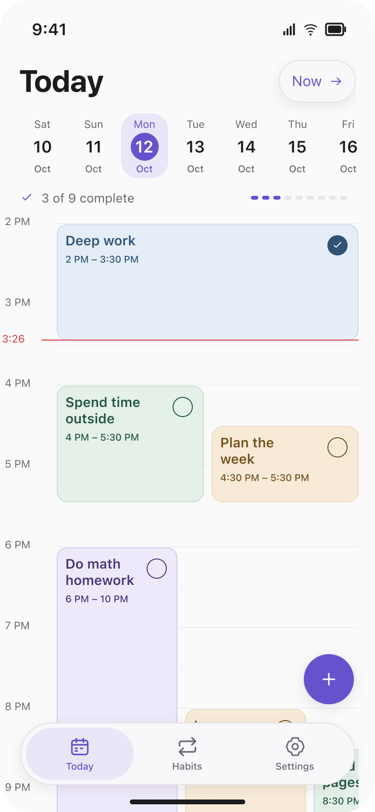
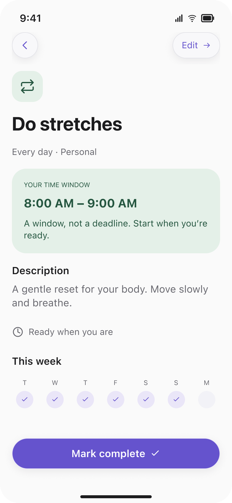
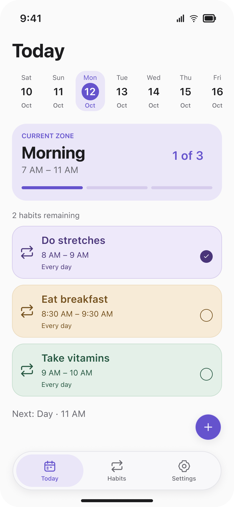
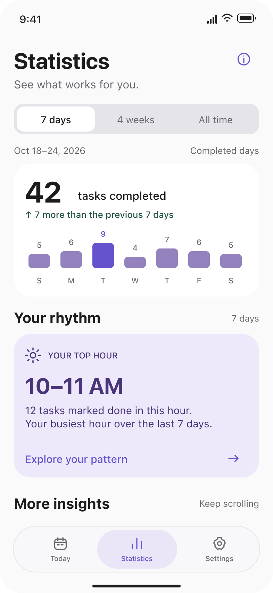
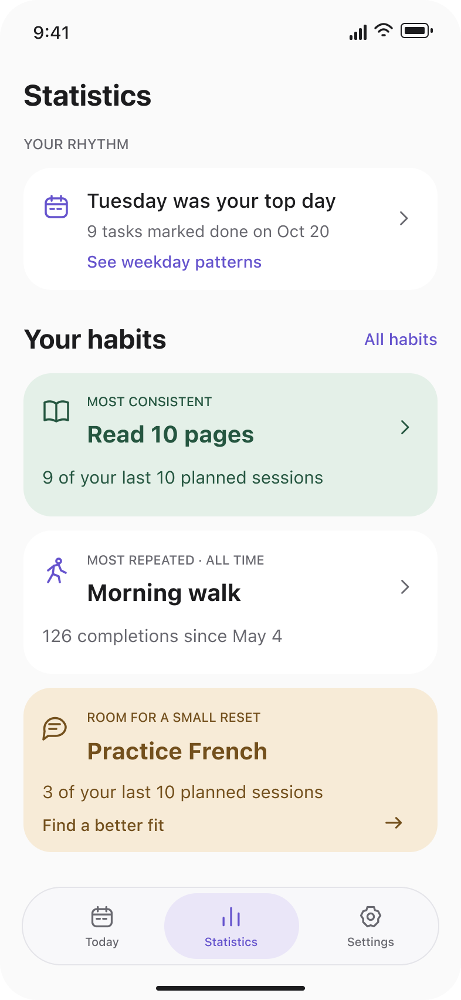
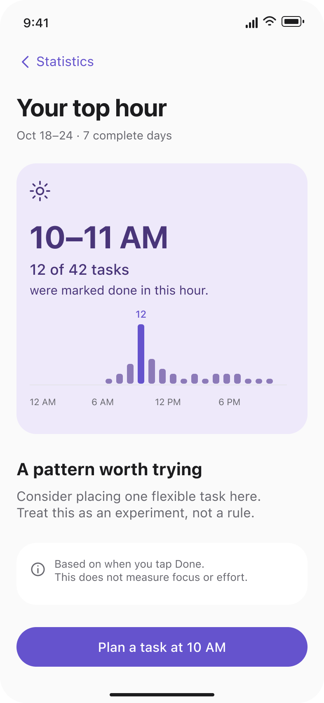
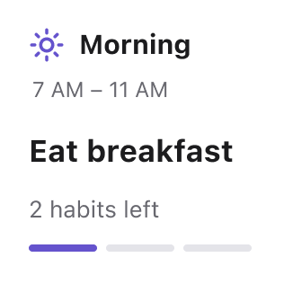
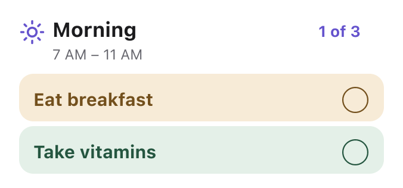
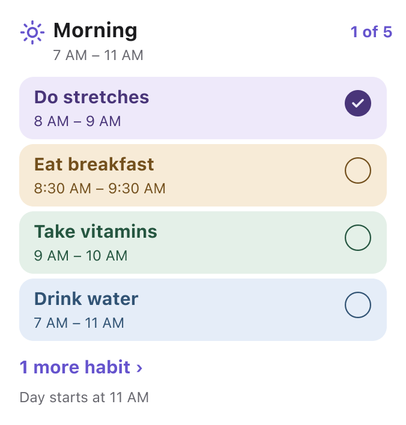

  <h3 align="center">Daywell</h3>
  
Habits-traking iOS app

## Features

* Specify a time window for each habit and task
* Always know what to do right now - no more fatiguing 10+ tasks for the whole day
* Explore insights with deep dive into your statistics
* Get reminders at the start of a habit, so you never forget about one
* Tweak different aspects of the app to your own liking - appearance, today layout, default time windows and more

## Tools

* SwiftUI
* Swift Concurrency (async/await)
* SPM (Swift Package Manager) - used to split application code into local modules and isolate Core modules from Feature ones
* [TCA (Swift Composable Architecture)](https://github.com/pointfreeco/swift-composable-architecture) - used for application architecture and primary tool for features presentation layers

## App Screenshots

  
  
  
  
  
  

## Widget Screenshots

  
  
  

