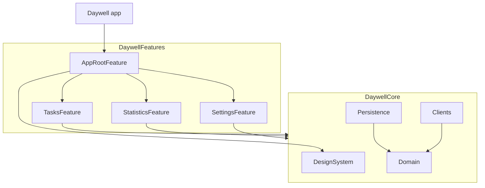
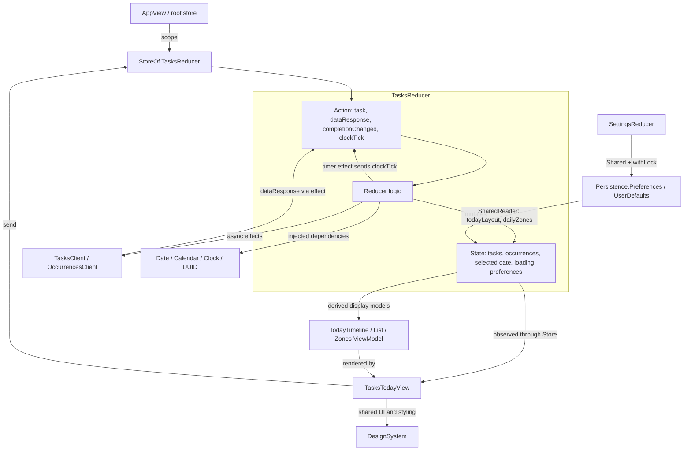

  <h3>Daywell</h3>
  <h4>Habit tracker with scheduled time window for each habit</h4>

## Tools

* SwiftUI
* Swift Concurrency (async/await)
* SPM (Swift Package Manager) - used to split application code into local modules and isolate Core modules from Feature ones
* [TCA (Swift Composable Architecture)](https://github.com/pointfreeco/swift-composable-architecture) - used for application architecture and as a primary tool for features presentation layers
* Swift Data with iCloud synchronization
* Swift Testing and UI testing with XCTestCase

## Features

* Set a specific time window for each habit and task
* Always know what to do right now - focus only on relevant tasks for the current time, reducing overwhelm
* Explore insights with deep dive into your statistics
* Receive reminders when it's time to start a habit, so you never forget about one
* Tweak different aspects of the app to your own liking - appearance, today's layout, default time windows and more

## App Screenshots

## Widget Screenshots

<table>
  <tr>
    <td rowspan="2" valign="top">
      
    </td>
    <td>
      
    </td>
  </tr>
  <tr>
    <td>
      
    </td>
  </tr>
</table>

## Architecture

The SwiftUI app uses TCA and two local Swift packages. `DaywellApp` creates a single root store through `AppBootstrap`; `AppView` scopes it to the Today, Statistics and Settings tabs.

| Package / module | Responsibility |
| --- | --- |
| `DaywellFeatures / AppRootFeature` | App bootstrap, root state/reducer and tab composition |
| `DaywellFeatures / TasksFeature`, `StatisticsFeature`, `SettingsFeature` | Independent feature views, states, actions and reducers |
| `DaywellCore / Domain` | Value models, validation and scheduling rules: tasks, occurrences, dates and time windows |
| `DaywellCore / Clients` | Injectable dependencies for fetching data and accessing system behavior |
| `DaywellCore / Persistence` | Shared settings preferences backed by UserDefaults and persistence implemented with SwiftData and iCloud integration |
| `DaywellCore / DesignSystem` | Reusable SwiftUI components, colors, appearance and layout constants |

Arrows below mean **depends on**. Each tab feature depends on all four Core modules; features do not depend on one another. External libraries are omitted.

### Screen Example: Today

The Today screen is `TasksTodayView`, backed by `StoreOf<TasksReducer>`. The view sends actions and observes state; the reducer handles actions, updates state and runs effects through injected dependencies.

On `.task`, an effect fetches tasks and occurrences, then sends `.dataResponse` back to the reducer. Completion actions update occurrence records in state. Settings changes reach Today through shared preferences, without a direct dependency on `SettingsFeature`. The Today view models derive display data from state; they do not own separate mutable stores.
